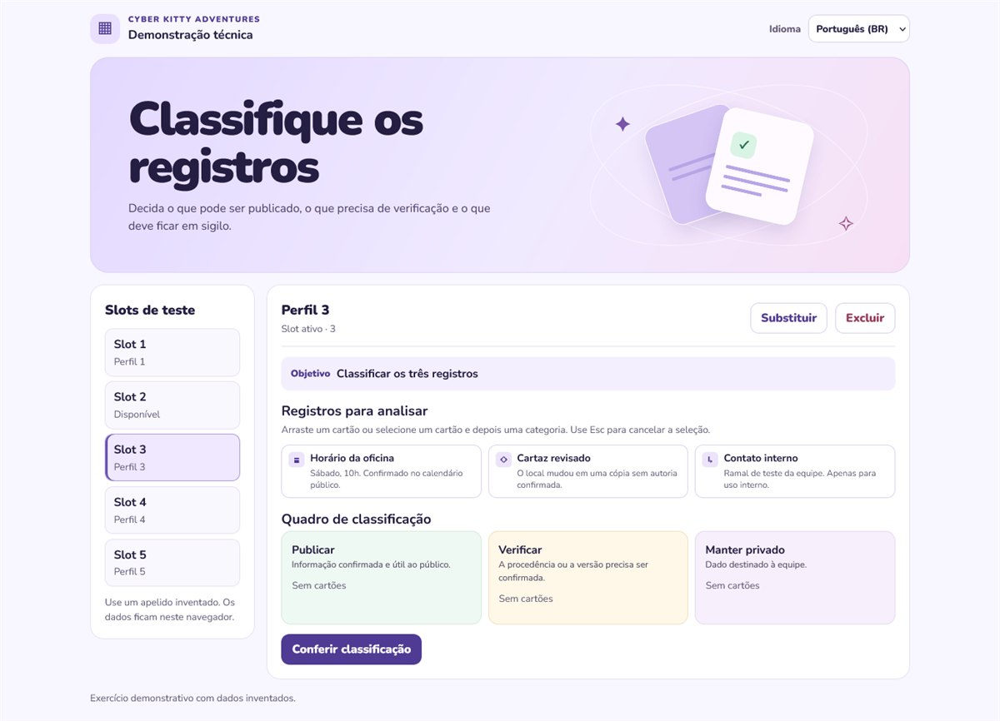
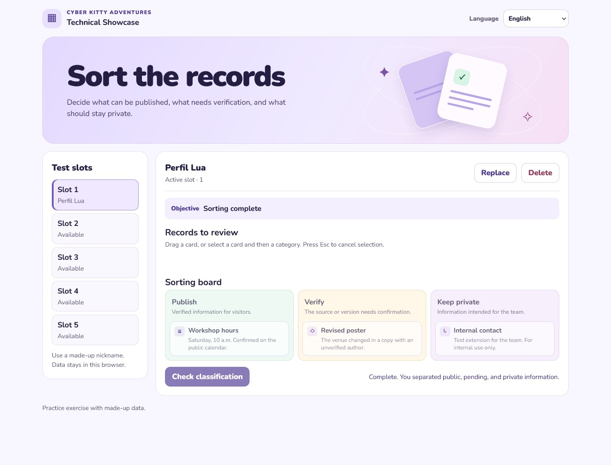

# Cyber Kitty Adventures — Technical Showcase


**Interactive Systems, State Management & Cybersecurity Education**

A browser-based exercise about deciding which records can be published, which need verification, and which should stay private. It presents the save system, mission state, localization, and interactions developed for the showcase of a larger cybersecurity education project.

*Em português: uma demonstração interativa de persistência, objetivos e localização aplicada à educação em cibersegurança.*

## Live demo

**[Play the public demo](https://cyber-kitty-technical-showcase.vercel.app/)** · No sign-in required

Create a fictional profile, sort the three records, and reload the page to resume. Switch between English and Brazilian Portuguese at any point. Saves belong to the browser origin, so progress on the hosted demo is separate from a local session.



_Classification activity with a fictional profile._



_Checkpoint restored after reloading in English._

## Cyber Kitty Adventures — Chapter 1

The full game introduces beginners to cybersecurity through storytelling, exploration, and practical challenges in Byteberry Town.

**Interested in playtesting Chapter 1?** Contact **Larissa Albuquerque** at [kerlalarissa@gmail.com](mailto:kerlalarissa@gmail.com) for playtesting details.

Cyber Kitty Adventures is an independent fan project. Third-party characters and artwork belong to their respective owners. Licensing discussions are ongoing. The project has no official affiliation with Sanrio.

**Em português.** A demo técnica está disponível acima. Para conhecer ou testar o Capítulo 1 do jogo educativo, escreva para Larissa Albuquerque pelo e-mail [kerlalarissa@gmail.com](mailto:kerlalarissa@gmail.com).

## About the project

Cyber Kitty Adventures introduces beginners to cybersecurity through practical decisions about privacy, verification, and information handling. The showcase focuses on a single classification exercise with fictional records and a purpose-built interface. Its scope is the technical exercise. The full campaign, characters, sprites, soundtrack, and Phaser scenes belong to the separate game.

## Features

- Five independent save slots with profile creation, replacement, and deletion.
- Versioned local persistence with state validation and stale revision detection.
- Mission checkpoints for both partial and completed classifications.
- English and Brazilian Portuguese localization with a saved language preference.
- Drag and drop or select a record and choose a category. Use Tab and Enter or Space to operate the controls and Escape to cancel selection.

## Tech stack and architecture

**TypeScript 5.7.3**, HTML, CSS, and native browser APIs. Node.js 22 or newer runs the build, local server, and built-in test runner. The deployed application consists of static files.

| Path | Responsibility |
| --- | --- |
| `src/saves.ts` | Slot storage, versioned serialization, validation, and revision checks |
| `src/mission.ts` | Classification rules, objective states, and completion checks |
| `src/locales.ts` | Typed PT-BR and English message catalogs |
| `src/main.ts` | UI rendering, pointer and keyboard events, dialogs, and checkpoint updates |
| `web/` | HTML, styles, the Nunito font, and its license notice |
| `scripts/` | Static build and loopback preview server |
| `tests/` | Automated tests with in-memory storage |

## Getting started

Install dependencies from the repository folder.

```powershell
npm.cmd ci
```

Start the development server.

```powershell
npm.cmd run dev
```

Open [the local demo](http://127.0.0.1:4173/). Restart the command after editing to rebuild. Outside PowerShell, use `npm` in place of `npm.cmd`.

```powershell
npm.cmd run typecheck
npm.cmd run build
npm.cmd test
```

Preview the current production build.

```powershell
npm.cmd run preview
```

The build writes to `dist/`. `preview` serves the current build. Stop the development server first or run `npm.cmd run preview -- 4174` to use another port.

## Testing and engineering decisions

The eight tests cover slot isolation and selection, checkpoint reloads, replacement and deletion conflicts, invalid records and blocked storage, failed writes, classification completion, malformed assignments, and translation key consistency.

Each successful classification writes a checkpoint to the active slot. The storage layer validates JSON and detects stale revisions already visible when a write begins. `localStorage` offers no transaction across tabs. Browser storage and native controls let the exercise run without a backend, sign-in, or external service dependency.

## Credits, provenance, and licensing

**Larissa Albuquerque** created the concept, directed the project, shaped its narrative and educational goals, and reviewed its development. See the [provenance and contribution notes](docs/PROCEDENCIA.md).

[Nunito](web/Nunito-OFL.txt) is distributed under the SIL Open Font License 1.1. TypeScript uses Apache-2.0. The license for the showcase code is pending.
